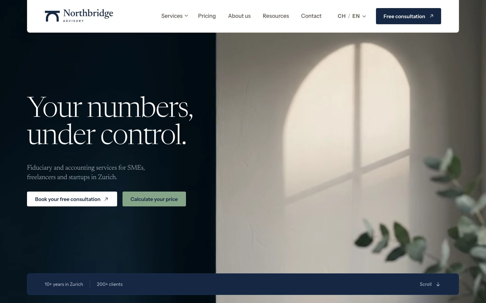
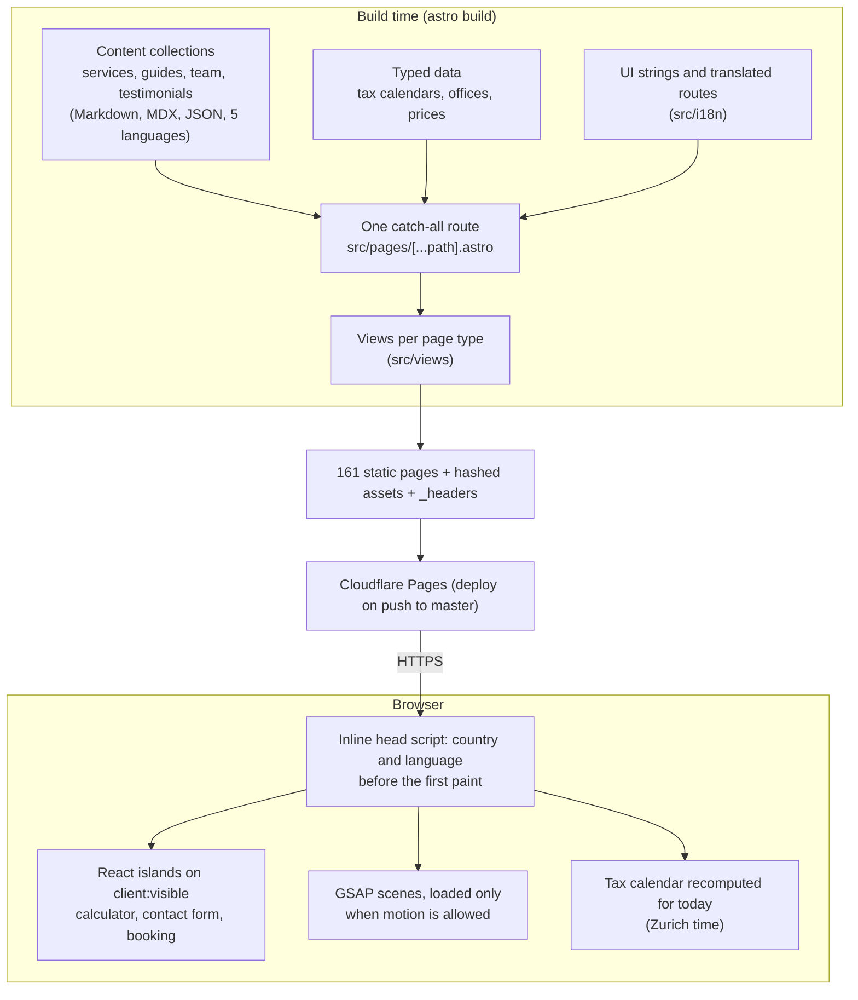
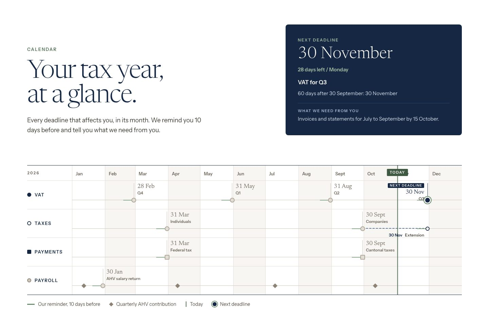
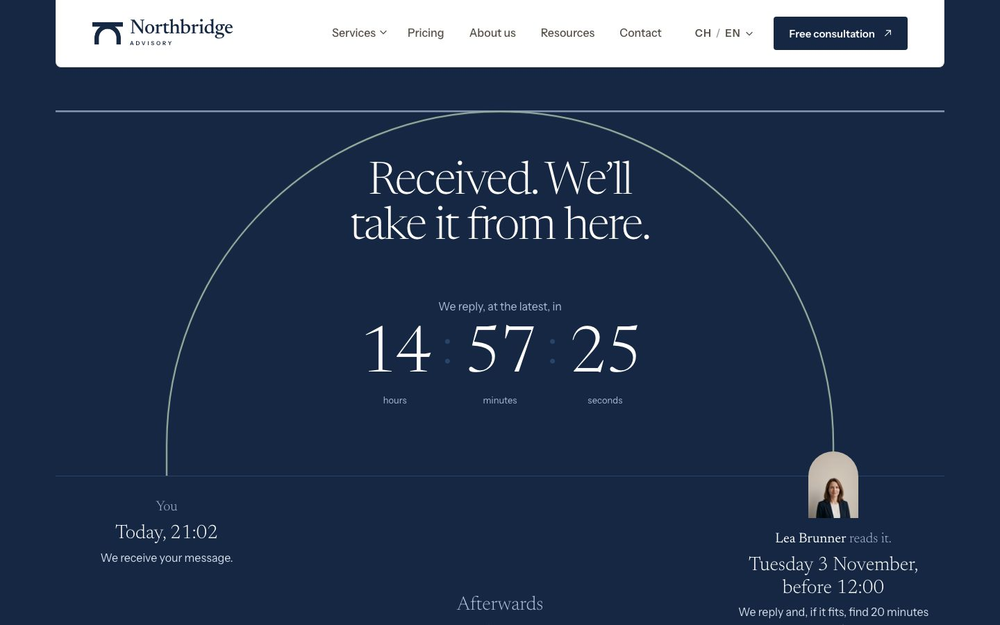

# Northbridge Advisory

> A website for a fiduciary and accounting firm in Zurich, built as static HTML with Astro 7, React 19 islands, TypeScript and Tailwind CSS 4, deployed on Cloudflare Pages.

[](https://www.typescriptlang.org/)
[](https://astro.build/)
[](https://pages.cloudflare.com/)
[](https://www.w3.org/WAI/standards-guidelines/wcag/)
[](#licenses--attribution)

**Live:** [northbridge-124.pages.dev](https://northbridge-124.pages.dev)

Northbridge offers bookkeeping, VAT, payroll, company formation and startup advisory to small businesses. The site explains each service in plain language, shows every tax deadline of the year for the visitor's country, estimates a monthly price in a minute and leads to a free 20-minute consultation. It runs in five languages (German, French, Italian, English and Spanish) and adapts to five countries (Switzerland, Germany, France, Italy and Spain).

_Northbridge is a fictional company. I built it as a portfolio project to show how I approach a real client website from start to finish: brand system, content, front end, accessibility, performance and testing._

**This repository is public on purpose as a portfolio work sample.** If you are a recruiter or hiring manager reading this, treat it as concrete evidence of how I work: static-first architecture, progressive enhancement, WCAG 2.2 AA accessibility, responsive layouts that adapt rather than shrink, and brand and business rules enforced by tests.

A few places worth a direct look in the codebase:

- [`src/lib/fiscal/deadlines.ts`](src/lib/fiscal/deadlines.ts): tax deadlines written as legal rules ("60 days after the quarter", "second working day after 1 May") and resolved for any year, with each country's holidays and weekend rule. [`deadlines.test.ts`](src/lib/fiscal/deadlines.test.ts) pins the official 2026 dates for all five countries.
- [`src/layouts/BaseLayout.astro`](src/layouts/BaseLayout.astro): the inline script that sets country and language before the first paint, from the browser's time zone and language, with no IP lookup and no third-party service.
- [`src/lib/pricing/no-loose-prices.test.ts`](src/lib/pricing/no-loose-prices.test.ts): fails the build if a price appears anywhere outside [`config.ts`](src/lib/pricing/config.ts). [`no-hex.test.ts`](src/lib/no-hex.test.ts) and [`contrast.test.ts`](src/lib/contrast.test.ts) do the same for the brand colours.
- [`src/views/ThanksView.astro`](src/views/ThanksView.astro): the confirmation page, where the message crosses the brand's arch and a live countdown runs to the reply, office holidays included.
- [`tests/foundations.spec.ts`](tests/foundations.spec.ts): Playwright and axe on every page type, keyboard navigation, the mobile menu and pages with JavaScript turned off.
- [`docs/DECISIONS.md`](docs/DECISIONS.md): the choices that shaped the project, what was ruled out and why.



---

## Technical Highlights

- **Static first:** Astro renders all 161 pages to HTML at build time. React hydrates only the calculator, the contact form and the booking calendar, and only when they scroll into view. Everything works without JavaScript.
- **Language and country are separate settings:** a French speaker in Zurich sees Swiss prices, legal forms and tax dates in French. The HTML ships one variant per country and CSS shows the active one, so switching is instant and there is no flash on load. Heavy variants (five tax calendars on one page) wait in `<template>` elements until needed.
- **Rules, not dates:** the tax calendar is computed from legal rules for the current year, in Zurich time, both at build time and in the browser. Next January it updates itself.
- **Responsive by context:** checked at thirteen sizes from 320 to 2560 px, phones in landscape included. Full-screen scroll scenes only pin on screens tall enough for them, the pricing comparison keeps three columns on a phone without sideways scrolling, and cards respond to their own width through container queries.
- **Accessibility and performance:** WCAG 2.2 AA, axe in the browser tests, keyboard and screen reader checked, `prefers-reduced-motion` respected everywhere. Lighthouse on mobile scores 100 for accessibility, best practices and SEO on every page measured, and 93 to 100 for performance.
- **Privacy by default:** no tracking cookies, no third-party scripts, self-hosted fonts. The Cal.com booking embed only loads after explicit consent.

---

## Architecture Overview



More detail in [docs/ARCHITECTURE.md](docs/ARCHITECTURE.md).

---

## Project Structure

| Folder           | Technology               | Responsibility                                                                        |
| ---------------- | ------------------------ | ------------------------------------------------------------------------------------- |
| `src/pages`      | Astro                    | A single catch-all route that maps every translated URL to its view                   |
| `src/views`      | Astro                    | One view per page type, shared by all languages                                       |
| `src/components` | Astro, React             | UI, layout, page sections, React islands and GSAP scenes                              |
| `src/content`    | Markdown, MDX, JSON, Zod | Services, country variants, guides, team and testimonials in five languages           |
| `src/data`       | TypeScript               | Tax calendars per country (with their legal sources) and office details               |
| `src/i18n`       | TypeScript               | UI strings per language, type-checked against the Spanish file, and translated routes |
| `src/lib`        | TypeScript, Vitest       | Pricing, tax deadlines, country logic, contact hours, SEO and their unit tests        |
| `src/styles`     | Tailwind CSS 4           | Design tokens, typography and the reading layout                                      |
| `tests`          | Playwright, axe-core     | End-to-end journeys, accessibility, keyboard, no-JS and country detection             |
| `docs`           | Markdown                 | Architecture notes, decisions and screenshots                                         |

---

## Core Features

### 1. Five languages, five countries

- **Separate settings:** language and country are chosen independently in the header and remembered in the browser.
- **Country-specific content:** currency, legal forms (GmbH, SL, SAS, SRL), service descriptions, office, tax calendar, guides and client quotes.
- **Sensible first visit:** a visitor from Zurich lands on the Swiss site in German; one from Geneva with a French browser gets French. A manual choice always wins.

### 2. The tax year

- **A real calendar:** every VAT, tax, payment and payroll deadline of the year for the selected country, on a yearly chart and as a list, with our reminder ten days before.
- **Next deadline:** the date, the days left and what we need from the client, computed on the day you visit.
- **Checked against official sources:** ESTV, AEAT, gesetze-im-internet.de, impots.gouv.fr and the Agenzia delle Entrate.



### 3. Price calculator

- **Three questions:** company type, invoices per month and employees, with the recommended package and a price range in the visitor's currency.
- **Shareable:** the answers live in the URL, and a screen reader hears each new estimate.

### 4. Contact, booking and confirmation

- **Contact:** the actual reply time in Zurich time (working days and office holidays), the office's week and a hand-drawn walking map.
- **Booking:** a demo calendar, or Cal.com after consent. Since the company isn't real, nothing is sent: a short notice explains that before the confirmation page.
- **Confirmation:** the message crosses the arch from "You, today" to the person who reads it, with a live countdown to the reply or to the booked call.



---

## Engineering Decisions & Documentation

- [Decision log](docs/DECISIONS.md): static first, language versus country, no IP geolocation, tax rules, responsive rules and what actually moved Lighthouse.
- [Architecture](docs/ARCHITECTURE.md): rendering, routing and languages, countries, tax deadlines, pricing, styling, motion and testing.


---

## Local Development

### Prerequisites

- Node.js 22.23 or higher (24 recommended)
- npm

### Setup & Run

1. Clone and install dependencies:

   ```sh
   git clone https://github.com/marcmendezb/northbridge.git
   cd northbridge
   npm install
   ```

2. Start the dev server:

   ```sh
   npm run dev        # http://localhost:4321
   ```

3. Build the static site:
   ```sh
   npm run build      # static site in dist/
   npm run preview
   ```

Copy `.env.example` to `.env` to set the site URL or a real Cal.com link. Without one, the booking page shows the demo calendar.

---

## Quality Assurance & Testing

```sh
# Type checking (astro check)
npm run check

# Linting
npm run lint

# Unit tests: pricing, tax deadlines for five countries, office hours, i18n parity, contrast, no loose hex or prices
npm run test

# End-to-end and accessibility tests (Playwright + axe-core; starts the dev server)
npm run test:e2e
```

Cloudflare Pages builds and deploys every push to `master`.

---

## Licenses & Attribution

- **Source code:** all rights reserved. The code is public so you can review it, not for reuse.
- **Company, team, clients and prices:** made up. The photos are AI-generated.
- **Tax and legal facts:** real and sourced, current when checked in late 2026, but not tax advice.
- **Typography:** Newsreader by Production Type and Instrument Sans by Instrument, both under the SIL Open Font License, self-hosted through Fontsource.

---

## Author

**Marc Mendez**  
Full-stack developer & MarTech specialist. Seven years in marketing, three building products. Based near Zürich, Switzerland.

- Portfolio: [marcmendezb.com](https://marcmendezb.com)
- GitHub: [@marcmendezb](https://github.com/marcmendezb)
- Email: [marcmendezb@gmail.com](mailto:marcmendezb@gmail.com)
